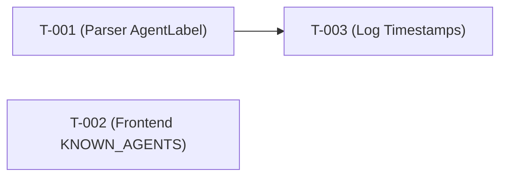

# CodeFree Provider AgentLabel 修复、前端注册与消息时间戳提取 任务清单（Tasks）

## 1. 元数据

| 项 | 内容 |
|---|---|
| Spec ID | SPEC-AV-001 |
| 关联Spec | `docs/specs/SPEC-AV-001/spec.md` |
| 关联Design | `docs/specs/SPEC-AV-001/design.md` |
| 作者 | srd18901883260 |
| 创建日期 | 2026-11-10 |
| 状态 | Draft |

## 2. 任务清单

| Task ID | 归属Spec | 任务描述 | 关联FR/AC | 依赖Task | 并行标识 | 验收标准 | 单元测试类/方法 | 单Task测试命令 | 状态 | Commit SHA |
|---|---|---|---|---|---|---|---|---|---|---|
| T-001 | SPEC-AV-001 | 移除 `internal/parser/codefree.go` 中的 `codefreeAgentLabel` 函数和 `path` 包导入，将 `AgentLabel` 设为空字符串并添加解释注释 | FR-001；AC-001-1, AC-001-2 | None | P | `codefreeAgentLabel` 函数不存在于 codefree.go；`path` 包不在 import 列表中；`AgentLabel` 字段为空字符串；`go vet ./internal/parser/` 无错误 | `TestLoadCodeFreeSession_UserAndAssistant` 验证 `sess.AgentLabel == ""`；`TestLoadCodeFreeSession_MultipleTurns` 验证 `sess.AgentLabel == ""` | `go test ./internal/parser/ -run TestLoadCodeFreeSession_UserAndAssistant,TestLoadCodeFreeSession_MultipleTurns -v` | Done | — |
| T-002 | SPEC-AV-001 | 在 `frontend/src/lib/utils/agents.ts` 的 `KNOWN_AGENTS` 列表新增 `{ name: "codefree", color: "var(--accent-purple)", label: "CodeFree" }` 条目 | FR-002；AC-002-1 | None | P | `KNOWN_AGENTS` 数组包含 `name: "codefree"` 条目；该条目 `label` 为 `"CodeFree"`；`agentLabel("codefree")` 返回 `"CodeFree"` | 代码审查确认条目存在（前端无独立单元测试，通过规范校验验证） | `go test ./internal/parser/ -run TestCodeFreeProvider_ParsePath -v`（验证 parser 端不回归） | Done | — |
| T-003 | SPEC-AV-001 | 新增 `internal/parser/codefree_logs.go` 实现 `loadCodeFreeLogTimestamps` 和 `resolveTurnTimestamps`；在 `codefree.go` 中集成日志扫描和三级时间戳填充；在 `codefree_provider.go` 中传递 `root` 参数 | FR-003；AC-003-1, AC-003-2, AC-003-3 | T-001 | S | `loadCodeFreeLogTimestamps` 能扫描日志目录并提取 turn 时间戳；`resolveTurnTimestamps` 三级策略正确填充：Pass 1 日志真实值、Pass 2 相邻线性插值、Pass 3 session 级均匀插值；`codefree.go` 中消息携带 per-turn Timestamp；`go vet ./internal/parser/` 无错误 | `TestResolveTurnTimestamps_AllFromLog`、`TestResolveTurnTimestamps_PartialLog_FillFromPreceding`、`TestResolveTurnTimestamps_PartialLog_FillFromFollowing`、`TestResolveTurnTimestamps_PartialLog_MiddleGap`、`TestResolveTurnTimestamps_NoLog_FallbackInterpolation`、`TestResolveTurnTimestamps_NoLog_SingleTurn`、`TestResolveTurnTimestamps_Empty`、`TestLoadCodeFreeLogTimestamps_NoLogsDir`、`TestLoadCodeFreeLogTimestamps_WithLogFile`、`TestCodefreeLogTimestampMap_Parse`、`TestCodefreeLogTimestampMap_EmptyMap`、`TestLoadCodeFreeSession_WithLogTimestamps`、`TestLoadCodeFreeSession_PartialLogTimestamps` | `go test ./internal/parser/ -run "TestResolveTurnTimestamps\|TestLoadCodeFreeLogTimestamps\|TestCodefreeLogTimestampMap\|TestLoadCodeFreeSession_WithLogTimestamps\|TestLoadCodeFreeSession_PartialLogTimestamps" -v` | Todo | — |

字段规则：

- Task ID采用`T-xxx`或`T-<DOMAIN>-xxx`，在当前Spec内唯一；归属Spec必须与当前目录一致。
- 状态仅允许`Todo`、`In Progress`、`Done`。
- 并行标识仅允许`P`或`S`：`P`表示不存在依赖冲突，`S`表示必须串行。
- 依赖为空时必须填写`None`，不得留空。
- 一个Task必须能够在一次实现会话中独立完成并验证。
- 一个Task必须对应一个最终本地代码Commit；创建Commit后回填真实Commit SHA。

## 3. AC—Task—单元测试映射

| AC ID | 覆盖Task | 测试类/方法 | 测试命令/选择器 | 预期结果 | Gate 4实际结果 |
|---|---|---|---|---|---|
| AC-001-1 | T-001 | `TestLoadCodeFreeSession_UserAndAssistant` | `go test ./internal/parser/ -run TestLoadCodeFreeSession_UserAndAssistant -v` | `sess.AgentLabel == ""` | 通过 |
| AC-001-1 | T-001 | `TestLoadCodeFreeSession_MultipleTurns` | `go test ./internal/parser/ -run TestLoadCodeFreeSession_MultipleTurns -v` | `sess.AgentLabel == ""` | 通过 |
| AC-001-2 | T-001 | `go vet` 验证 | `go vet ./internal/parser/` | 无未使用导入错误 | 通过 |
| AC-002-1 | T-002 | 规范校验（代码审查） | 审查 `KNOWN_AGENTS` 包含 `{ name: "codefree", color: "var(--accent-purple)", label: "CodeFree" }` | 条目存在且 label 为 "CodeFree" | 通过 |
| AC-003-1 | T-003 | `TestResolveTurnTimestamps_AllFromLog` | `go test ./internal/parser/ -run TestResolveTurnTimestamps_AllFromLog -v` | 全部 turn 使用日志真实时间戳 | 未执行 |
| AC-003-1 | T-003 | `TestLoadCodeFreeLogTimestamps_WithLogFile` | `go test ./internal/parser/ -run TestLoadCodeFreeLogTimestamps_WithLogFile -v` | 日志文件扫描正确提取时间戳映射 | 未执行 |
| AC-003-1 | T-003 | `TestLoadCodeFreeSession_WithLogTimestamps` | `go test ./internal/parser/ -run TestLoadCodeFreeSession_WithLogTimestamps -v` | 会话加载时日志时间戳正确填充到消息 | 未执行 |
| AC-003-1 | T-003 | `TestCodefreeLogTimestampMap_Parse` | `go test ./internal/parser/ -run TestCodefreeLogTimestampMap_Parse -v` | 日志时间戳映射解析正确 | 未执行 |
| AC-003-2 | T-003 | `TestResolveTurnTimestamps_PartialLog_FillFromPreceding` | `go test ./internal/parser/ -run TestResolveTurnTimestamps_PartialLog_FillFromPreceding -v` | 前导缺失用后续已知 turn 线性插值 | 未执行 |
| AC-003-2 | T-003 | `TestResolveTurnTimestamps_PartialLog_FillFromFollowing` | `go test ./internal/parser/ -run TestResolveTurnTimestamps_PartialLog_FillFromFollowing -v` | 尾部缺失用前面已知 turn 线性插值 | 未执行 |
| AC-003-2 | T-003 | `TestResolveTurnTimestamps_PartialLog_MiddleGap` | `go test ./internal/parser/ -run TestResolveTurnTimestamps_PartialLog_MiddleGap -v` | 中间缺失在前后已知 turn 间均匀插值 | 未执行 |
| AC-003-2 | T-003 | `TestLoadCodeFreeSession_PartialLogTimestamps` | `go test ./internal/parser/ -run TestLoadCodeFreeSession_PartialLogTimestamps -v` | 部分日志缺失时会话消息时间戳正确插值 | 未执行 |
| AC-003-3 | T-003 | `TestResolveTurnTimestamps_NoLog_FallbackInterpolation` | `go test ./internal/parser/ -run TestResolveTurnTimestamps_NoLog_FallbackInterpolation -v` | 无日志时用 session 起止时间均匀插值 | 未执行 |
| AC-003-3 | T-003 | `TestResolveTurnTimestamps_NoLog_SingleTurn` | `go test ./internal/parser/ -run TestResolveTurnTimestamps_NoLog_SingleTurn -v` | 无日志单 turn 用 session startTime | 未执行 |
| AC-003-3 | T-003 | `TestResolveTurnTimestamps_Empty` | `go test ./internal/parser/ -run TestResolveTurnTimestamps_Empty -v` | 空 turn 列表返回空切片 | 未执行 |
| AC-003-3 | T-003 | `TestLoadCodeFreeLogTimestamps_NoLogsDir` | `go test ./internal/parser/ -run TestLoadCodeFreeLogTimestamps_NoLogsDir -v` | 日志目录不存在时返回空映射 | 未执行 |
| AC-003-3 | T-003 | `TestCodefreeLogTimestampMap_EmptyMap` | `go test ./internal/parser/ -run TestCodefreeLogTimestampMap_EmptyMap -v` | 空映射查找返回零值 | 未执行 |

映射规则：

- 必须覆盖`spec.md`中的全部适用AC，不得增加不存在的AC。
- 每条AC至少关联一个Task和一个具体测试类/方法，不得只写测试文件或笼统测试类型。
- 同一测试覆盖多个AC时必须逐条登记。
- Gate 4只有在对应测试真实存在、已执行且通过时，才能将实际结果标记为`通过`。
- 失败、错误、跳过、缺失或未执行均阻断统一Push和Code MR创建。

## 4. 依赖图



> T-001 和 T-002 无依赖关系，可并行执行。T-003 依赖 T-001（在 codefree.go 中集成日志扫描，需 T-001 已完成 AgentLabel 修改）。T-002 修改前端文件，与 T-003 互不影响。

> 依赖图必须无环；Task不得依赖自身；依赖的Task必须真实存在；标记为并行的Task不得存在直接或间接依赖冲突。

## 5. 实施与提交顺序

```text
选择一个Todo Task
→ 状态改为In Progress
→ 实现代码和单元测试
→ 执行该Task的单元测试
→ 测试通过后状态改为Done
→ 立即创建一个本地Task Commit并回填SHA
→ 不Push、不创建MR
→ 继续下一个Task
```

全部Task完成后：

```text
执行全量单元测试
→ 逐条核对全部AC测试结果
→ Gate 4完整检查
→ 全部通过后统一Push全部Task Commit
→ 创建一个Code MR
```

## 6. 全量单元测试记录

| 测试命令 | 退出码 | 执行数 | 通过数 | 失败数 | 跳过数 | 结果 |
|---|---:|---:|---:|---:|---:|---|
| `go test ./internal/parser/ -run "TestLoadCodeFreeSession_UserAndAssistant\|TestLoadCodeFreeSession_MultipleTurns" -v` | 0 | 2 | 2 | 0 | 0 | 通过 |
| `go vet ./internal/parser/` | 0 | — | — | — | — | 通过 |
| `go test ./internal/parser/ -run "TestLoadCodeFreeSession\|TestCodeFreeProvider\|TestParseCodeFreeStateJSON" -v` | 1 | 16 | 14 | 2 | 0 | 部分通过（2个既有Windows路径测试失败，与本次变更无关） |

> 本期只记录L2判断所需主要信息，不要求在Tasks中保存完整测试框架原始输出。

## 7. 自检清单（评审辅助，不作Gate依据）

- [x] Spec ID及Spec/Design引用有效且一致。
- [x] Task ID唯一，字段完整，状态值和并行标识合法。
- [x] 每个Task可独立实现、独立单测并对应一个本地Commit。
- [x] 全部FR/AC均已映射到Task，不存在孤儿AC。
- [x] 每条AC均已映射到具体测试类/方法和可执行命令。
- [x] 所有依赖Task真实存在，依赖图无环，并行标识无冲突。
- [x] 实施顺序满足依赖关系。

## 8. 变更历史

| 日期 | 版本 | 变更内容 | 作者 |
|---|---|---|---|
| 2026-11-10 | 1.0.0 | 初始版本 | srd18901883260 |
| 2026-11-11 | 1.1.0 | 新增 T-003 覆盖 FR-003 消息时间戳提取，三级兜底策略测试映射 | srd18901883260 |

> 本文件原地修改；整个项目只保留这一份`tasks.md`并与唯一`spec.md`同目录，禁止创建第二套或任何版本副本。
